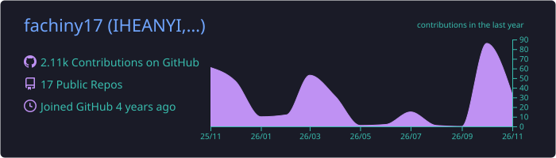
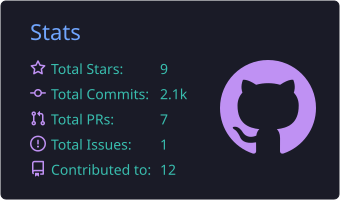
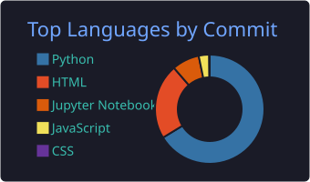
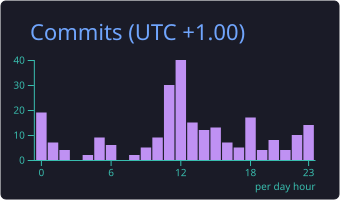

# Favour Chisom Iheanyi

**Mechanical Engineering Graduate · AI/ML Practitioner · Software Developer**

 

---

## About Me

- 🌍 **Location:** Nigeria
- 🎓 **Background:** Mechanical Engineering
- 🧠 **Focus:** AI/ML, software development, and continuous learning
- 🤝 **Open to:** collaborations across AI/ML, software development, and mechanical engineering
- ⚽ **Outside of code:** football and short-distance athletics

---

## Tech Stack

<table>
  <tr>
    <td><b>Languages</b></td>
    <td></td>
  </tr>
  <tr>
    <td><b>Frameworks &amp; Databases</b></td>
    <td></td>
  </tr>
  <tr>
    <td><b>Machine Learning</b></td>
    <td></td>
  </tr>
  <tr>
    <td><b>Data Science</b></td>
    <td>
      
      
      
      
    </td>
  </tr>
  <tr>
    <td><b>Tools</b></td>
    <td></td>
  </tr>
</table>

---

## Featured Projects

<table>
  <tr>
    <td width="50%" valign="top">

### NexLearn
Real-time speech-to-text for classrooms. Uses Deepgram Nova-3 and Flask to convert live speech into text instantly.

[Source code](https://github.com/fachiny17/NexLearn) · [Demo video](https://youtu.be/3a2gZvGKZvU)

</td>
    <td width="50%" valign="top">

### NucleiScan AI
AI-powered breast cancer diagnostics platform. Combines deep learning with clinical decision support to assist medical professionals.

[Source code](https://github.com/fachiny17/NucleiScan_AI) · [Live app](https://nucleiscanai.streamlit.app/)

</td>
  </tr>
  <tr>
    <td width="50%" valign="top">

### Naija Flavours
A web app celebrating Nigerian cuisine, featuring recipes, cultural insights, and a food gallery.

[Source code](https://github.com/fachiny17/naija-flavours) · [Live site](https://naija-flavours.onrender.com/)

</td>
    <td width="50%" valign="top">

### Machine Learning Journey
A structured record of my machine learning learning path, with projects and notebooks from DeepTech, TensorFlow, and more.

[Source code](https://github.com/fachiny17/machine_learning)

</td>
  </tr>
</table>

[**View all repositories →**](https://github.com/fachiny17?tab=repositories)

---

## GitHub Analytics

---

## Contribution Snake

  <picture>
    <source media="(prefers-color-scheme: dark)" srcset="https://raw.githubusercontent.com/fachiny17/fachiny17/output/github-snake-dark.svg" />
    
  </picture>

---

## Connect With Me

---

---

**Open to collaborations on impactful AI and engineering projects.**